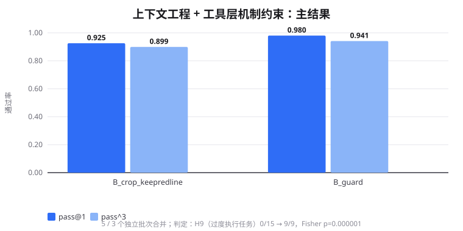
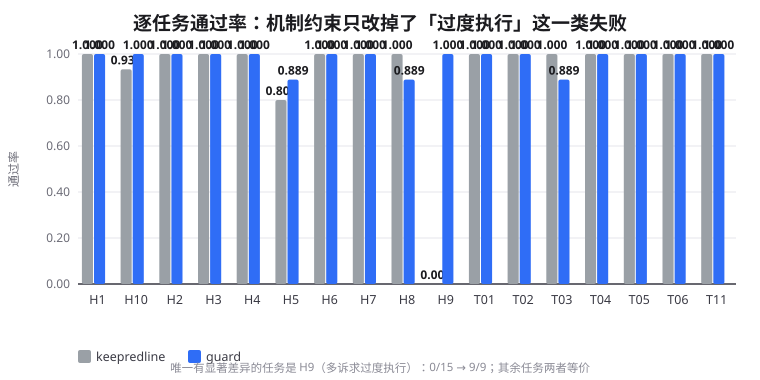
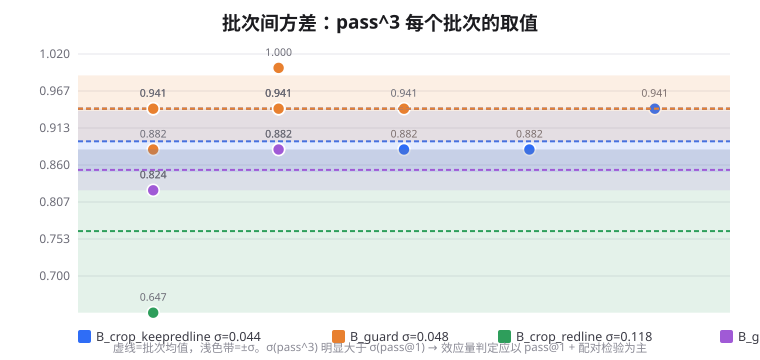

# Agent 可靠性评测床

用 [Qwen-Agent](https://github.com/QwenLM/Qwen-agent)（17.2k★ / Apache-2.0）搭的一套评测床，
外加一组对照实验：**上下文该怎么组织、越权该怎么拦**，这两件事到底怎样才有效。

框架代码保持原样，改动集中在两处——与模型服务的对接层，以及评测与约束层。

## 四个数字

16 个独立批次、816 次运行、0 次中断，模型用 MiniMax-M3.1-Flash：

| | |
|---|---|
| 把「一次只办一件事」从 prompt 里的文字禁令改成工具层的机制约束 | 过度执行类任务 **0/15 → 9/9**，Fisher 检验 **p = 1e-6** |
| 整体 pass@1 | **0.925 → 0.980**（批次间 σ=0.015，约 3.7σ） |
| 在上游框架里定位到的缺陷 | **5 处**，其中 1 处会让原生 function calling 直接 400 |
| 规则的**措辞边界**——内容正确但边界模糊的规则，比没有这条规则更危险 | 零工具调用 **0.4% → 6.9%**，pass^3 **0.941 → 0.747**；措辞划清后回到 **2.0% / 0.941** |



---

## 1. 起点

调 agent 时有两件事几乎所有人都在做，但很少有人把它们量化：

1. **上下文怎么组织**——规则全塞进 prompt？按场景裁剪？写成要点？加一节"红线"？
2. **agent 越权怎么办**——靠 prompt 里写"不许做 X"？

这两件事看起来都不难，但到底哪种做法更有效，通常只有"感觉"。
而常见的评测方式是"跑一遍看总分"，总分噪声却大到足以淹没结论：
本项目实测，同一配置同一规则集，**批次间 pass^3 的极差达到 0.118**。

## 2. 做了什么

### 2.1 评测床（`src/qwen_agent_bench/`，不引入任何第三方依赖）

判分方式借鉴 [τ²-bench](https://github.com/sierra-research/tau2-bench)：
把**参考轨迹回放到一份干净的 DB** 得到目标终态，agent 的写操作发生在同一份 DB 上得到预测终态，
比对状态哈希——终态等价就算通过，不要求调用顺序一致。

- 一个中文电信客服域：9 个工具、19 条规则（单一事实源）、17 条任务
- 得分 = **DB 维度**（确定性）× **NL 断言**（模型判定）
- 判分器本身也做了验证：变异测试 9/9 全部正确拒绝；模型判定与确定性正则交叉核验 **255/255 一致**

### 2.2 把"上下文工程"拆成相互独立的开关再测

要让「呈现方式」成为一个干净变量，被对比的两份策略文本必须内容一致，否则收益里会混着
"人工摘要多写了什么"的偏置。因此规则收敛到**单一事实源**（`domain/policy_rules.yaml`），
再由渲染器产出不同版式：

| 做法 | 结论 | 效应量 |
|---|---|---|
| **要点化**（规则写成要点，而不是长段落） | 有效 | +0.117（2.8σ） |
| **按场景相关性裁剪** | **有害**——会把跨场景的隐性约束一起裁掉 | −0.235 |
| **红线保底**（绝对不能违反的规则无条件保留） | 必要 | — |
| **全量注入**（完全不裁） | 不如裁剪——不相关的规则造成噪声干扰 | — |

> 配方是：**裁剪到场景相关 + 红线保底 + 判据要点化**。
> 也就是"给最少够用的上下文，但把绝对不能违反的规则无条件保留"。

### 2.3 把约束从 prompt 挪到工具层

这一条和直觉相反：

| 手段 | 落点 | 实测 |
|---|---|---|
| 文字禁令「一次只办一件事」 | prompt | agent 读成"**别多做事**"→ 连必要的查询都不做 → 该做不做 |
| **机制约束**（工具层拦截） | tool | agent **做该做的、做不了不该做的** → 过度执行 0/15 → 9/9 |

> 用禁止性规则压制越界，会让模型变得畏首畏尾。
> 要解决"做多了"，该收紧**可行域**（机制约束），而不是加**禁令**（文字约束）。

### 2.4 规则的**措辞边界**是一个独立变量

规则的**内容**和规则的**措辞边界**是两个独立的变量。同一条规则，边界划不划清楚，
行为可以完全相反。

实验做法：同一条规则集做两种措辞版本做单变量对照——
一条把「已失败/被拒绝的操作」和「还没开始的操作」混在一起，另一条把两者划清。

| | 说"我先查"的措辞 | **整轮零工具调用** | pass^3 |
|---|---|---|---|
| 边界清晰的规则集 | 22~31/51 | **0/51** | 0.941 |
| 边界模糊的规则集 | 24~30/51 | **6~7/51** | **0.747** |

注意「我先查」这个说法**边界清晰的版本也有**——差别在于说完之后**有没有真的去查**。

> 这和「上下文工程」的发现是同一条线索：**风险不在规则"说了什么"，而在规则"管到哪里"**。
> 而且这类风险**看起来完全正常**——规则读起来是对的、也过了人工 review，只有跑起来才暴露。

可操作的做法两条：规则要划清边界（约束的是"已失败的操作"还是"还没开始的操作"），
以及加一个过程指标（本项目叫 `deferred_no_action`），让这类退化在归因里看得见。



## 3. 一点方法论上的事



同一配置、同一规则集，多个独立批次跑下来：

- **pass@1 的批次间 σ ≈ 0.015，pass^3 的 σ ≈ 0.044**（pass^3 对边界任务的单次翻转格外敏感）
- 所以效应量判定以 **pass@1 + 配对检验**为主，pass^3 只作参考
- 每个配置至少 3 个独立批次，合并后按任务算 pass^3

这套规范由四条硬性纪律构成，每一条都对应一类会让结论完全反转的失效模式：

| 纪律 | 对应的失效模式 |
|---|---|
| 「保留」与「置顶」必须解耦成两个开关 | 否则会把"红线被裁掉"误判成"裁剪有害" |
| 基础设施故障必须与模型能力失败**分开统计** | 否则端点限流造成的中断会被算成任务失败，分数整体塌陷 |
| 判分阈值必须小于**实验分辨率**（1/17 = 0.059） | 否则标准从一开始就够不着 |
| 任务的 gold 必须能追溯到策略里的一条规则 | 否则判的是"策略没规定的事" |

完整记录见 [`docs/实验方法与评判标准.md`](docs/实验方法与评判标准.md)。

## 4. 复现方式

```bash
# 1) 环境（拉上游 + 建 venv + 装依赖）
bash scripts/setup_env.sh

# 2) 十几秒看到全貌：环境自检 + 一次真实对话 + 打印已归档的对照结果
bash scripts/demo.sh

# 3) 完整复现（多批次，约 2.5 小时）
bash scripts/run_bench.sh --variant B_crop_keepredline --variant B_guard --trials 3 --jobs 2

# 4) 从原始结果重新生成汇总与图表（数字可复算）
.venv/Scripts/python.exe scripts/summarize.py
```

**环境要求**：Python 3.12 + 一个 OpenAI 兼容端点（本项目用 MiniMax）。
`scripts/*.sh` 会自动从 `~/.claude/settings.json` 读取已配置的 key，也可以自己设 `MINIMAX_API_KEY`。

**数字可复算**：[`results_summary/汇总.md`](results_summary/汇总.md) 由 `scripts/summarize.py`
从原始结果生成，批次分组写死在脚本里并注明对应的代码版本（不同版本产生的数据不能合并）。

## 5. 在上游框架里定位到的缺陷

接 MiniMax（OpenAI 兼容端点）时发现的，都在本仓库的封装层规避，**没有改动上游源码**：

| # | 缺陷 | 影响 | 上游状态 |
|---|---|---|---|
| 1 | 原生 function calling 的工具结果用 `id`，而不是 OpenAI 规范里的 **`tool_call_id`** | MiniMax 严格校验，直接 `400 tool result's tool id not found` | 已有 PR #917 |
| 2 | `setup.py` 漏声明 `numpy`/`soundfile`/`ipykernel`/`regex`/`tqdm` | `import qwen_agent` 直接失败 | 已有 PR #968 |
| 3 | **非流式**回复同时带 `reasoning_content` 和 `tool_calls` 时，`tool_calls` 被丢掉 | agent 永远不调工具（流式是正常的） | **本仓库已提修复** |
| 4 | `yield response + output` 反复吐出累积消息 | 工具调用计数虚高 | 上游内部设计 |
| 5 | 并行 tool_call 缺 `extra.function_id` 时 id 重复 | 端点 `400 duplicate tool_call id: 1` | **本仓库已开 issue** |

### 5.1 对上游的贡献

第 3、5 两项上游还没覆盖，已经把修复和讨论准备好了：

| | 内容 | 材料 |
|---|---|---|
| **PR** | 修复非流式路径丢弃 `tool_calls`（影响所有返回 `reasoning_content` 的模型） | [`docs/上游贡献/PR-修复non-streaming丢tool_calls.md`](docs/上游贡献/PR-修复non-streaming丢tool_calls.md) |
| **Issue** | 并行 tool_call id 重复导致端点 400（附三种修法与配对约束分析） | [`docs/上游贡献/ISSUE-并行tool_call_id重复.md`](docs/上游贡献/ISSUE-并行tool_call_id重复.md) |

复现证据来自真实端点，不是推测：

```
Q: 请用工具计算 (137*89 - 42) / 7 的结果      （MiniMax-M3.1-Flash，非流式）
   reasoning_content=有(297字) | tool_calls=['calc'] | finish=tool_calls
→ 上游只返回 content + reasoning_content，tool_calls 丢失
```

补丁附了 3 个回归测试，并已验证：能干净应用到干净上游、补丁前失败补丁后通过、
上游测试套件没有新增失败（基线 50 failed 全部来自缺 `DASHSCOPE_API_KEY`）。

哪些已被上游覆盖、哪些还没有，见 [`docs/上游贡献/README.md`](docs/上游贡献/README.md)。

## 6. 局限

1. **1 个模型 / 1 个域 / 17 个任务** —— 结论**不能外推**（换模型、换域是否成立还没有验证）
2. **用户是脚本化的**，没有测"面对混乱用户会怎样"
3. **没有跑官方基线**（τ²-bench / Claw-Eval 的官方分数），只做了组内对照，不宣称绝对水平
4. **任务是自写的**；不过判分与 agent 实现是解耦的（gold 由参考轨迹独立回放得出），而且经过多轮回审
5. 机制约束依赖**业务关键词表**，换域要重写 —— 这是方法的适用边界
6. NL 断言这一维区分度偏弱，有效判分主要靠 DB 维度

## 7. 目录

```
src/qwen_agent_demo/     对接层：接上游 + 协议兼容补丁（工具调用 / ReAct / 多 Agent）
src/qwen_agent_bench/    评测床：域、工具、规则、任务、判分、变体、运行器
docs/                    选型调研、评测床设计、实验方法与评判标准、历次实验报告、两份方法论
scripts/                 clone / setup / verify / demo / run_bench / summarize / analyze / publish
results_summary/         可复算的汇总与图表（由 summarize.py 生成）
tests/                   86 项单元测试，全部不调用模型
```

## 8. 文档

| 文档 | 内容 |
|---|---|
| [`docs/调研报告-选型.md`](docs/调研报告-选型.md) | 框架对比、网络与环境实测、接入验证 |
| [`docs/评测床设计.md`](docs/评测床设计.md) | 评测床规格：域、工具、规则、任务、判分、变体阶梯 |
| [`docs/实验方法与评判标准.md`](docs/实验方法与评判标准.md) | **每步开工前的回审清单、评判标准、方差分析** |
| [`docs/实验报告-v8.md`](docs/实验报告-v8.md) | 上下文工程与机制约束的主结果 |
| [`docs/实验报告-v9.md`](docs/实验报告-v9.md) | 规则的措辞边界：一个独立于规则内容的变量 |
| [`docs/评测与调优方法论.md`](docs/评测与调优方法论.md) | Reflexion / OpenJudge / Claw-Eval 的方法与步骤 |
| [`docs/安全管控方法论.md`](docs/安全管控方法论.md) | 腾讯朱雀 A.I.G、Agent 三道关、安全作为评测维度 |
